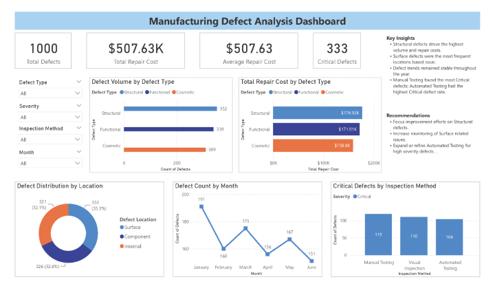

# Hi, I'm Mario Perales

Business Systems Analyst | Process Improvement | Power Platform | Operational Analytics | PMP | MBA

I am a Business Systems Analyst and Data Professional with 13+ years of experience helping organizations improve processes, optimize workflows, and implement technology enabled solutions that drive measurable business results.

My background combines business analysis, operational analytics, process improvement, and solution development. I enjoy working at the intersection of business processes, technology, and data to create practical solutions that improve organizational performance and decision making.

---

## Current Focus

I'm currently expanding my expertise in:

- Data Analytics
- SQL
- Power BI
- Business Intelligence
- Data Visualization
- Process Automation
- Microsoft Power Platform

---

## Featured Project

### Manufacturing Defect Analysis Dashboard

**Tools Used:**
Excel | MySQL | Power BI

Developed an end-to-end analytics project designed to identify quality trends, defect patterns, repair cost drivers, and inspection effectiveness.

Project Activities:

- Data preparation and validation in Excel
- SQL-based analysis in MySQL
- Interactive dashboard development in Power BI
- Business insight generation and recommendations

Key Findings:

- Structural defects represented the highest defect volume and repair costs.
- Surface defects were the most common defect location.
- Manual Testing identified the greatest number of Critical defects.
- Defect activity remained relatively stable throughout the reporting period.

**Dashboard**

  

**Project Repository**

[https://github.com/mvperales/manufacturing-defect-analysis](https://github.com/mvperales/manufacturing-defect-analysis)

---

## Technical Skills

### Data Analytics & Business Intelligence

- SQL
- MySQL
- Power BI
- Excel
- Power Query
- KPI Reporting
- Dashboard Development
- Data Validation
- Data Visualization

### Microsoft Power Platform

- Power Apps
- Power Automate
- SharePoint Online
- Forms Integration
- Workflow Automation

### Business Analysis

- Requirements Gathering
- Stakeholder Management
- Process Analysis
- Process Improvement
- Root Cause Analysis
- Business Process Mapping
- Solution Design

### Project & Process Management

- Agile Collaboration
- Change Management
- Process Optimization
- Governance
- Cross-Functional Leadership

---

## Professional Highlights

### Southern California Edison

- Gathered requirements and led implementation of Power Platform solutions supporting approximately 300 annual requests.
- Reduced processing time from 5 days to 1 day.
- Eliminated 200+ annual emails through workflow automation.
- Developed dashboards and KPI reporting solutions supporting operational planning and leadership decision-making.

### Analytics & Reporting Experience

- Developed reporting and analytics solutions supporting operational, project, and business performance management.
- Built dashboards, KPI tracking systems, and reporting tools that improved visibility and decision support.
- Partnered with stakeholders to translate business needs into actionable reporting and technology solutions.

---

## Certifications

- Project Management Professional (PMP)
- Business-Led Developer
- Power BI for Data Analysis
- SQL for Data Science

---

## Education

**Master of Business Administration (MBA)**  
University of Phoenix

**Bachelor of Applied Science**  
Automated Manufacturing & Electronics

---

## Professional Interests

- Business Analysis
- Data Analytics
- Business Intelligence
- Process Improvement
- Automation
- Power Platform
- Operational Excellence

---

## Connect With Me

### LinkedIn

[www.linkedin.com/in/mario-v-perales](https://www.linkedin.com/in/mario-v-perales/)

### Email

[mvperales@yahoo.com](mailto:mvperales@yahoo.com)

---

> Turning business challenges into technology solutions and data into actionable insights.
